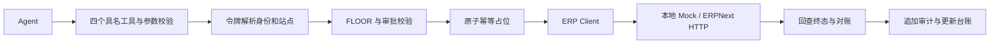

# ERP Agent Gateway

为已有 ERP 系统添加一层受控的 Agent 工具入口。Agent 查询采购单与库存、计算采购缺口、创建采购单草稿；Gateway 负责身份、站点隔离、审批、幂等、写后对账和审计。当前以 TypeScript 库和命令行场景运行，Agent 侧采用确定性业务编排。

本项目是 Parallight Cohort-2 W12「给已有的 ERP 外挂一层 Agent」的课程实现。原始要求见 [PROJECT.md](PROJECT.md)，设计说明见 [Architecture Note](gateway/submission/architecture-note.md)。默认使用本地 mock，无需 ERPNext、Docker 或外部 API 凭据。

## 快速开始

使用 Node.js 24（本次验证版本：24.21.0）和 npm：

```bash
cd gateway
npm ci
npm run preflight
npm run demo:mock
```

演示场景中，需求为 60、库存为 40，最终只补建数量为 **20** 的采购单草稿，沿用原单单价 70 和仓库 `Stores - ADC`。写后重新读取单据确认 `docstatus=0`，演示结束后按确切单号清理，采购单回到 6 张。

## 工作方式



| 能力 | 实现与约束 |
| --- | --- |
| 窄工具 | 查询、读取、创建采购草稿、提交四个具名工具；固定 DocType 白名单与参数校验 |
| 身份与隔离 | 从平台令牌解析身份；拒绝请求体中的身份或站点字段 |
| 风险与审批 | 本地风险表只能加严 FLOOR；提交等不可逆操作需要绑定内容摘要的审批凭证 |
| 持久幂等 | 业务字段构造稳定键；文件锁、租约归属和状态持久化；跨进程去重 |
| 对账 | 响应丢失先记录 `uncertain`，按业务字段回查；不自动重放未知结果的写入 |
| 审计与注入隔离 | 只追加审计；宿主自由文本携带来源，以不可信数据处理 |

## 验证

在仓库根目录执行：

```bash
npm --prefix gateway run typecheck
npm --prefix gateway run mock:baseline
npm --prefix gateway test
node scripts/eval-public.mjs
```

在 `gateway/` 中执行综合场景：

```bash
node src/capstone/run.mjs
```

本次验证：**15 个测试文件通过，134 项测试通过，1 项真实 PostgreSQL 测试跳过**。综合场景验证首次响应丢失后的对账和同键去重。完整记录见 [docs/verification.md](docs/verification.md)。GitHub Actions 会执行类型检查、基线采集、测试、种子校验、综合场景和公开评分自检。首次检出后须先生成 `gateway/reports/baseline.json`，该运行产物不提交到仓库。

### 公开评分入口的目录兼容

课程下发包移除了 `starter/` 层，而原始评分器的静态检查仍查找 `starter/gateway/...`。新增的 `node scripts/eval-public.mjs` 会在临时目录恢复该布局，运行原始评分入口，将报告复制回 `gateway/reports/eval-public.json`，最后清理临时目录。评分器、场景、fixture 和已有测试断言保持原样。

直接在下发布局中运行 `npm run eval:public` 仍会遇到原始静态路径问题。`verify:starter` 另依赖不随学员包下发的教师端 `tasks/*.yaml`，不列为本仓库 CI 的通过项。

## 目录与阅读顺序

```text
gateway/
  src/             Gateway、工具、身份、策略、台账、审计与 ERP 适配器
    agent/         采购事实查询、缺口计算和草稿组装
    capstone/      综合场景可执行入口
    store/         PostgreSQL 台账与审计适配器
  tests/           公开测试与补充的边界测试
  fixtures/        课程种子数据与摘要
  mock/scenarios/  十个故障与业务场景
  evaluator/       原始公开评分器
  store/           PostgreSQL 表结构与审计约束
  submission/      设计说明、失败分析与学习反思
grading-model/     评分模型配套练习
scripts/           目录兼容评分入口与干净发布副本生成器
docs/              本次验证记录
```

建议依次阅读 [工具面](gateway/src/tools.ts)、[Gateway 主流程](gateway/src/gateway.ts)、[持久幂等台账](gateway/src/ledger-persistent.ts)、[对账](gateway/src/reconcile.ts) 和 [综合场景](gateway/src/capstone/run-impl.ts)。工程命令表见 [gateway/README.md](gateway/README.md)，复盘见 [Failure Analysis](gateway/submission/failure-analysis.md) 与 [学员反思](gateway/submission/learner-reflection.md)。

## 可选真实环境

需要连接 ERPNext 时，在 `gateway/` 里将 `.env.example` 复制为 `.env`，填写受限账号，再运行 `npm run smoke:live`。本次仅验证 mock 和 PostgreSQL 假驱动；真实 ERPNext、真实 PostgreSQL、部署中的身份及审批服务和课程隐藏评测均未验证。

## 整理后提交 GitHub

从课程工作区首次整理时，在仓库根目录运行：

```bash
node scripts/prepare-release.mjs
```

命令在 `.publish/` 下生成独立副本，只复制源码、测试、课程要求、文档和选定证据。不复制 `.env`、依赖、运行台账、个人课程评审回执或旧 `.git`。首次发布应在该副本中初始化新 Git 仓库，再推送到自己的远端；本地课程工作区和配置继续保留。
